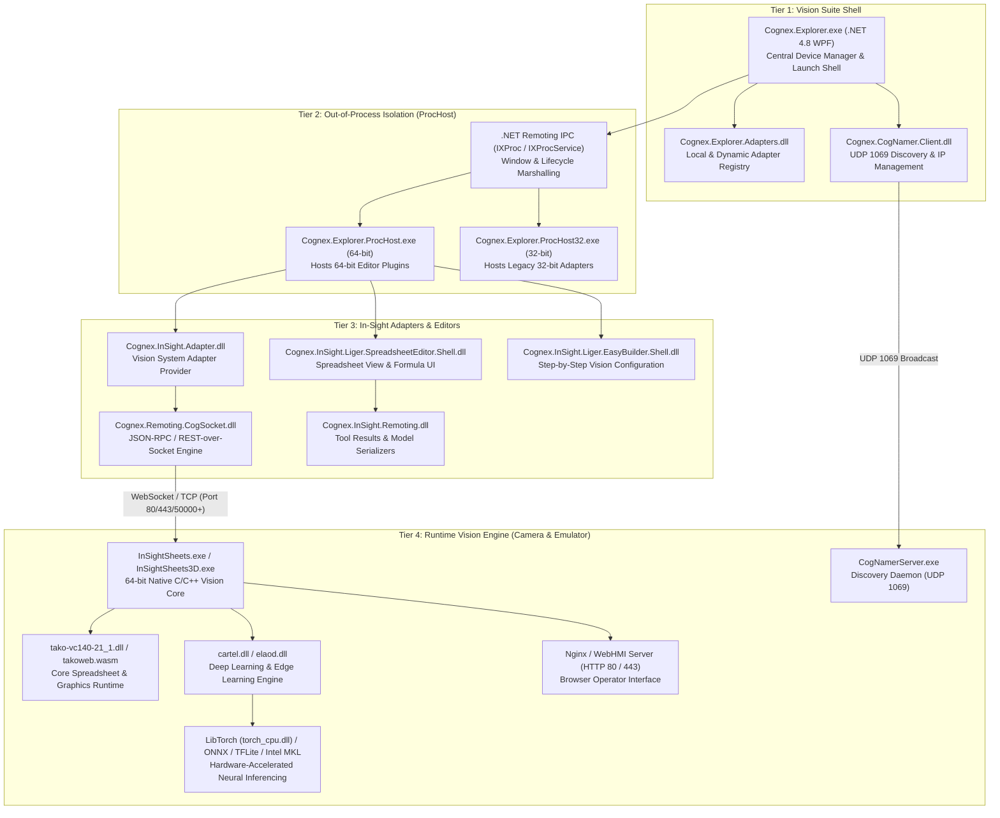

# Cognex In-Sight Vision Suite - Architecture Specification

## 1. Executive Summary
This document specifies the software architecture, process topology, inter-process communication (IPC), and component interactions of the Cognex In-Sight Vision Suite (v25.1.0), reverse-engineered from installed binaries at `C:\Program Files\Cognex\In-Sight` and aligned with technical reference documentation in `Ref docs`.

The system employs a 4-tier modular, distributed architecture separating the front-end management shell, isolated editor hosts, remoting adapters, and the underlying native vision execution engine and emulator runtimes.

---

## 2. System Architecture Topology

---

## 3. Subsystem Breakdown

### 3.1 Tier 1: Suite Shell (`Cognex.Explorer.exe`)
- **Runtime**: .NET Framework 4.8 (x86/x64 AnyCPU, strong-name signed).
- **Role**: Primary user interface for camera discovery, network configuration, firmware upgrading, job backup/restore, and launching environment editors.
- **Key Modules**:
  - `Cognex.Explorer.exe`: Application entry point, WPF MainWindow, theme engine.
  - `Cognex.Explorer.Adapters.dll`: Discovers available device adapters via `LocalAdapterRepository` from `..\In-Sight Vision Suite Adapters`.
  - `Cognex.CogNamer.Client.dll`: Manages UDP broadcast discovery and IP configuration.
  - `Cognex.Explorer.Integration.dll`: Device lifecycle and job manager integration.

### 3.2 Tier 2: Process Host (`ProcHost.exe` & `ProcHost32.exe`)
- **Role**: Process isolation mechanism ensuring crashes, memory overhead, or legacy bitness requirements in editors or third-party adapters do not crash the primary Suite Shell.
- **IPC Mechanism**:
  - Interface: `IXProc` and `IXProcService` defined in `Cognex.Explorer.XProc.dll`.
  - Transport: .NET Remoting over Named Pipes / IPC channels.
  - Method `IXProc.Start(IAppService service, string entryPoint, string action, Dictionary<string, object> arguments)` spawns and controls the embedded editor.
  - Bit-bridging: `ProcHost32.exe` runs 32-bit adapters under 64-bit Windows transparently.

### 3.3 Tier 3: In-Sight Adapters & Editors
- **Role**: High-level domain logic, Spreadsheet model, EasyBuilder configuration wizards, and communications bridge.
- **Manifest Architecture**:
  - Located in `In-Sight Vision Suite Editors\In-Sight\In-Sight 25.1.0\Manifest.json`:
    - **Spreadsheet Editor**: EntryPoint `Cognex.InSight.Liger.SpreadsheetEditor.Shell.dll`
    - **EasyBuilder Editor**: EntryPoint `Cognex.InSight.Liger.EasyBuilder.Shell.dll`
- **Key Assemblies**:
  - `Cognex.InSight.dll`: Core client representation (`CvsInSight`, `CvsCogSocketSheet`, `CvsSensor`, `CvsCell`).
  - `Cognex.Remoting.CogSocket.dll`: Implements JSON-RPC message framing (`get`, `put`, `post`, `event`, `listen`, `unlisten`, `response`).
  - `Cognex.InSight.Remoting.dll`: Serialization models for ViDi (Deep Learning), ViDiEL (Edge Learning), OCRMax, and 2D/3D graphics shapes.
  - `Cognex.Tuna.Control.dll`: Custom WPF controls for spreadsheet grid rendering, cell selection, and formula editing.

### 3.4 Tier 4: Runtime Vision Engine (`InSightSheets.exe` & `InSightSheets3D.exe`)
- **Role**: The core vision execution pipeline running either natively on physical smart cameras (embedded Linux / RTOS) or in Windows emulator mode (`InSightSheets.exe`, 64.5 MB PE32+).
- **Execution Engine**:
  - Pure native C/C++ compiled with MSVC 14 (Visual Studio 2015-2022 CRT: `MSVCP140.dll`, `VCRUNTIME140.dll`).
  - Evaluates cell dependency graph across 328 built-in vision and mathematics functions.
  - Integrates Tako runtime (`tako-vc140-21_1.dll`) for cross-platform cell graphics and shape generation.
- **AI & Deep Learning Integration**:
  - `cartel.dll` (6.06 MB): Cognex proprietary deep learning inference and training orchestration.
  - `elaod.dll` (2.59 MB): Edge Learning Anomaly & Object Detection.
  - Framework Backends:
    - LibTorch: `torch_cpu.dll` (129.5 MB), `c10.dll`, `torchvision.dll`.
    - ONNX Runtime: `onnxruntime.dll` (8.45 MB), `onnx_proto.dll`.
    - TensorFlow Lite: `tensorflow-lite.dll` (5.95 MB), `tflite_shared_rsc.dll`.
    - Intel Math Kernel Library (MKL): `mkl_core.dll` (71.6 MB), `mkl_avx2.dll` (41.1 MB), `mkl_avx512.dll` (51.9 MB), `tbb.dll`.
  - Machine learning models stored in `.cbd` format (Cognex Binary Data).
